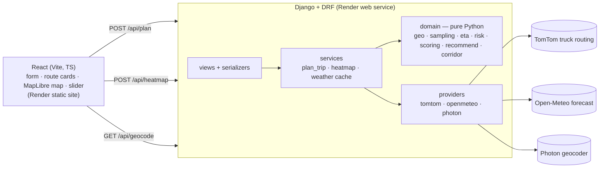

# Weather-Aware Truck Routing

A React + Django app that helps a truck driver pick the **safest** of three truck routes. For each route it checks the forecast at regular checkpoints, **for the hour the truck will actually reach each one**. It scores that weather with the provided wind, rain, snow and load-weight rules, recommends a route, and shows everything on a map with a 0–48 h weather heatmap.

- **Live app:** https://murtuza-truck-routing.onrender.com
- **API:** https://murtuza-truck-routing-api.onrender.com/api/health/ (free tier, so the first request after idle takes about 30–60 s to wake it)
- **Walkthrough (Loom):** _add the Loom URL here_

---

## What it does

1. **Input:** origin, destination, departure time, load weight (lb), and checkpoint spacing (10 / 25 / 50 mi). There are also one-click demo trips.
2. **Routes:** TomTom truck routing, using the rig's weight, returns up to 3 alternatives. If it returns fewer distinct routes, the app adds detour routes through waypoints to the side of the main route, so there are still 3 options.
3. **Checkpoints and ETAs:** a checkpoint goes every N miles plus the destination. Each ETA comes from TomTom's travel time at that point along the route, so city stretches are slow and interstates fast, instead of one average speed.
4. **Weather:** the Open-Meteo hourly forecast for the hour each checkpoint is reached: gusts, sustained wind, rain + showers, and snowfall.
5. **Risk:** each checkpoint is classified with the rule table and the load escalations. Every level comes with a plain-English reason, e.g. *"Gusts 47 mph with load 36,000 lb > 30,000 lb: Severe raised to No Travel"*.
6. **Recommendation:** routes are ranked by fewest No Travel miles, then Severe miles, then High miles, then lowest average risk, then shortest drive time. The app explains the pick against **every** other route, e.g. *"Route B beats Route C on travel time (8h 01m vs 8h 59m) and Route A on average risk (0.00 vs 0.14)."*
7. **Map:** shows all routes. The selected route is drawn in risk colors, with clickable checkpoints that show ETA, weather and reasons. A **heatmap** covers the trip corridor with a **0–48 h slider**: play and pause, risk, wind, rain or snow, and a truck marker that moves along the route in step with the slider.

## Rule interpretations

The brief leaves a few cases open. These are the choices made, and they're all covered by unit tests ([`backend/planner/tests`](backend/planner/tests)).

| Topic | Decision |
|---|---|
| **Band edges** | Bands are half-open, lower bound inclusive, so a value on a shared edge goes to the higher level (rain 0.25 in/hr is **High**). The brief writes No Travel as "> 1.00" and "> 3.0", so rain at exactly 1.00 in/hr and snow at exactly 3.0 in/hr stay **Severe**. Wind "25–34" is treated as continuous, so 34.6 mph is Moderate. |
| **Checkpoint risk** | The worst of wind (after the load rules), rain and snow. |
| **Load rules** | These only change the wind level. At 45–54 mph, a load **> 30,000 lb** (strictly) becomes **No Travel**; at 35–44 mph, a load **> 40,000 lb** becomes **Severe**; at ≥ 55 mph it's No Travel for any load. |
| **Which wind** | **Gusts**, because gusts are what blow over high-profile trailers. A form option switches to sustained wind. |
| **Rain** | `rain + showers` (liquid only). Open-Meteo's `precipitation` also counts snow's water equivalent, so it isn't used. |
| **Forecast hour** | Open-Meteo stamps each hour's gusts and precipitation at the **end** of that hour, so a truck passing at 14:20 uses the 15:00 value (the ETA rounded up to the next hour). |
| **Miles per level** | Each checkpoint owns the stretch from the midpoint with the previous checkpoint to the midpoint with the next one. The shares add up exactly to the route length, and one bad checkpoint isn't double-counted. |
| **Average risk** | Miles-weighted mean of the scores Low 0, Moderate 1, High 2, Severe 3, No Travel 4. |
| **Ranking** | Exactly the assessment's order, and nothing else: fewest **Severe miles** → fewest **High miles** → lowest **average risk** → shortest **travel time** (lexicographic, never a weighted sum). Miles are compared at 0.1 mi and average risk at 0.01, so float noise counts as a tie and the next criterion decides. Full ties keep TomTom's order. |
| **No Travel (safety constraint)** | Applied *before* ranking, not as an extra criterion: a route with any No Travel miles is **not eligible** and is never recommended. It's still shown, ranked after the eligible routes, with its badge and exclusion reason. If every route has No Travel, **nothing is recommended**. |
| **Missing weather** | A checkpoint with no valid forecast (missing, null, NaN or negative values, or outside the fetched forecast window) is **unknown**: it's shown in grey as "No forecast", its miles aren't scored, and the route can't be confirmed safe: it's not eligible while a fully forecast route without No Travel exists. If no route has a complete forecast, the best one with at least 50 % coverage is shown as a clearly labeled **provisional pick**. Below that there's too little data, so **nothing is recommended** and the banner says the weather was unavailable (with Open-Meteo's reason in a notice). Unknown is never treated as calm, and the heatmap marks missing cells with grey dots. |
| **No safe route** | If every route has No Travel miles, the banner says "No safe route at this departure time", **recommends nothing**, lists each route's No Travel miles, and suggests delaying. |
| **Route alternatives** | TomTom's alternatives are used as-is. Two count as the same route if they share ≥ 95 % of their road, measured geometrically: the share of each route's length within 0.3 mi of the other. If fewer than 3 distinct routes remain, the app asks TomTom for a route through a waypoint placed perpendicular to the origin→destination line at the main route's midpoint, offset by 15 % of the straight-line distance (15–100 mi), one on each side. A detour is kept only if it's distinct (≤ 85 % shared with every route), reasonable (≤ 1.4× the fastest route's distance and ≤ 1.5× its drive time), and doesn't drive out to the waypoint and back. Kept detours are labeled "Detour option" and their waypoint is shown on the map. Otherwise fewer routes are shown, with a notice saying why. |
| **Timestamps** | The departure must include a UTC offset. A naive time is rejected rather than guessed, because a wrong guess shifts every forecast hour. The UI sends the browser's local time as ISO with an offset. |
| **Slider window** | 0–48 h **from the departure time**, so the slider always covers the trip itself. |
| **Routing weight** | Load plus a 35,000 lb empty tractor-trailer (`TRUCK_TARE_LB`), sent to TomTom as gross vehicle weight. The risk rules use the load as entered. |
| **Out of scope** | Hours-of-service rest breaks are not modeled, so ETAs are pure drive time. Departure must be within 7 days, and the load at most 80,000 lb. |

## Architecture



- **`backend/planner/domain/`** holds all the rule logic as pure functions with no Django and no I/O, and it's unit-tested edge by edge.
- **`providers/`** are the only code that sees vendor JSON. They sit behind Protocols in [`base.py`](backend/planner/providers/base.py), so tests swap in fakes.
- **`services/`** do the orchestration:
  - Weather is looked up on the weather model's own **0.25° grid**. Checkpoints that share a cell share one lookup, and each cell is cached for an hour (checkpoints and heatmap share the cache).
  - Weather calls are batched and run with limited parallelism, retrying on 429 and 503.
  - A cell that still fails is marked **unknown**: its miles aren't scored, and the UI says so, so one bad cell doesn't fail the whole plan.
- **Errors** always come back in the same shape, `{"error": {"code", "message", "details?"}}`, which the form maps onto its fields.

### Why these providers

| Need | Choice | Why |
|---|---|---|
| Routing | **TomTom** `travelMode=truck` | Handles truck weight, up to 5 alternatives, and gives travel time at each point (for real ETAs). Free tier, no card. OpenRouteService was rejected because it caps alternatives at 100 km. |
| Weather | **Open-Meteo** `gfs_seamless` | Free, no key, hourly gusts, rain and snow, many points per request. MET Norway was rejected because it has no gusts and no rain/snow split outside the Nordics. |
| Geocoding | **Photon** | Free autocomplete over OpenStreetMap data, with no key. |
| Basemap | **OpenFreeMap** + **MapLibre GL** | Free vector tiles, WebGL rendering, no token. |

## Map performance

The map is half the grade, so it was measured rather than assumed.

- **Everything on the map is a WebGL layer**: routes, risk segments, checkpoints and the heatmap. Only the truck and the two trip endpoints are DOM markers.
- **The slider never changes data-driven paint.** In MapLibre, changing a data-driven paint property (like `heatmap-weight`) makes it pause and re-tile the source in its worker. Doing that on every slider frame stutters. Instead:
  - **The heatmap is 49 layers, one per forecast hour, built once.** The slider only changes `heatmap-opacity`, cross-fading the two neighboring hours, and MapLibre skips any layer whose opacity is 0.
  - **Checkpoints near the slider's time** are highlighted through **feature-state**, which costs no re-tiling.
  - **Measured:** 0 source reloads over 40 slider moves, and about 7 ms per move in the dev build.
- **Heatmap math** ([`lib/heatmap.ts`](frontend/src/lib/heatmap.ts)):
  - **One color scale:** every metric is mapped onto the 0–4 risk scale, so the same color means the same level whichever metric is shown, and the legend applies to all of them.
  - **Radius and intensity:** both are derived from the grid spacing so the summed Gaussian kernels reproduce the grid values at any zoom. Without this, the heatmap breaks into blobs when zoomed in.
- **Few API calls:** each plan makes 1 TomTom request, plus at most 2 detour requests and only when TomTom returns fewer than 3 distinct routes. An identical resubmit within 10 min reuses the answer. Weather is looked up per 0.25° grid cell rather than per checkpoint (95 cells for 159 checkpoints on Denver → SLC). Lookups are batched 25 per request, at most 3 in parallel, cached for 60 min and shared with the heatmap. Moving the slider makes no API calls. Every response's `meta` field reports these counts and timings.
- **Payloads:** geometry is simplified on the server (Douglas–Peucker, 30 m tolerance) and sent as encoded polylines, and responses are gzipped. The heatmap is about 6 KB on the wire.
- **Loading:** the map and MapLibre code are loaded lazily, so the form is usable straight away. The first page load also pings `/api/health/` to wake a sleeping free-tier backend.

## Run locally

Prerequisites: [uv](https://docs.astral.sh/uv/), Node 20+, and a free [TomTom key](https://developer.tomtom.com) (no card needed).

```bash
cd backend
cp .env.example .env          # set TOMTOM_API_KEY
uv sync
uv run python manage.py runserver        # http://127.0.0.1:8000
```

```bash
cd frontend
npm install
npm run dev                              # http://localhost:5173 (proxies /api to :8000)
```

## Tests and checks

```bash
cd backend && uv run pytest && uv run ruff check . && uv run ruff format --check .
cd frontend && npm run lint && npm run typecheck && npm test && npm run build
cd frontend && npx playwright install chromium && npm run test:e2e
```

- **Backend:** 218 tests, with no network needed: providers are mocked with recorded fixtures. Coverage includes:
  - **Rules:** every threshold edge (24.9/25/34.9/35…, rain 0.0999/0.10/…/1.00/1.0001), the load edges (30,000 vs 30,001 and 40,000 vs 40,001), and wind/rain/snow combinations.
  - **Bad data:** invalid, NaN or negative weather readings; malformed TomTom and Open-Meteo payloads; bounded retries.
  - **Ranking:** that the criteria are exactly the assessment's four, each tie-breaker, float-noise ties, deterministic full ties, that the provider's order never decides the winner (all permutations), and the eligibility constraint (No Travel never recommended, provisional picks, no recommendation when every route has No Travel).
  - **Routes:** geometric route similarity, duplicate alternatives, and detour rejection (too long, too slow, repeating an existing route, out-and-back spurs).
  - **Trip pipeline:** owned-miles sums, the round-up forecast-hour rule, ETA-based sampling, 1, 2 or 3 TomTom alternatives (detour fallback), and the route and weather caches.
  - **API:** validation, error shapes and status codes, and that error responses never leak keys or internals.
- **Frontend unit:** 14 tests for polyline decoding, heatmap weights and cross-fade, the truck position and status, and how risk miles are formatted.
- **End-to-end:** 15 Playwright tests in Chromium against the real UI and MapLibre map. Only `/api/*` and the basemap style are mocked, using fixtures generated by the real backend pipeline (`backend/scripts/export_e2e_fixtures.py`). They cover:
  - **Main flow:** form → loading state → 3 routes in backend rank order → selecting each route → checkpoint popup → the map fitted to the routes.
  - **Slider:** 0 / 12.5 / 48 h (frame opacities and truck status), metric switching, and that the slider triggers no refetch.
  - **Safety display:** a No Travel route excluded with its reason; no recommendation when every route has No Travel; a provisional pick with missing forecasts and grey heatmap dots; a detour labeled with its waypoint; only two routes, with the notice; and the checkpoint risk breakdown.
  - **Failures:** validation errors, a 502 from a provider, and server-side field errors.
  - **Other:** resubmitting, refreshing, and a 375 px phone layout.
- **CI:** [GitHub Actions](.github/workflows/ci.yml) runs all three suites on every push.

## Deploy (Render)

Everything runs on Render from one [Blueprint](render.yaml):

| Service | Type | Notes |
|---|---|---|
| `murtuza-truck-routing-api` | Docker web service (free) | Django + gunicorn. It sleeps after 15 idle minutes. The frontend pings `/api/health/` on page load to wake it. |
| `murtuza-truck-routing` | Static site (free, CDN) | The Vite build. It never sleeps, so the page loads instantly even while the API wakes. |

1. Open https://render.com/deploy?repo=https://github.com/murtuza777/spotter_labs_assessment and approve the Blueprint.
2. Paste your `TOMTOM_API_KEY` when prompted. Everything else is preset: CORS, the API URL in the frontend build, and a generated secret key.
3. Pushes to `main` redeploy both services, once Render's GitHub app has access to the repo (Render → Account settings → GitHub). Without it, Render gets no push webhooks, so deploy with the CLI: `render deploys create <service-id> --wait`.

**Keep warm (optional):** set the repository variable `API_HEALTH_URL`, and [keep-warm.yml](.github/workflows/keep-warm.yml) pings the API every 10 min. Free web services share 750 instance-hours a month per workspace, so turn this off once the review is over.

## Limitations and next steps

- **Latency (measured):**
  - **Cold plan:** 3.6–3.8 s. That's 1 TomTom request (2.6–9.5 s on its own, varying by run) plus 2–4 batched Open-Meteo requests.
  - **Identical resubmit:** 0.2 s with no external calls (route cache 10 min, weather cache 60 min).
  - **Heatmap:** 0.7–1.3 s cold, 0.06 s warm.
  - **Weather overloads:** when Open-Meteo's free tier is overloaded (seen during development, about 0.5 s per location), a cold plan can take 15–30 s.
- **Weather resolution:** the heatmap shows real Open-Meteo hourly forecasts on a corridor grid (0.25–1° spacing), smoothed for display. It isn't radar, and anything finer than the grid is interpolation.
- **Hours-of-service ETAs** (breaks after 8 h, rest after 11 h) would make long-trip ETAs, and so the forecast hours, more realistic.
- **"Leave later?" suggestions:** re-score departures at +2, +4 and +6 h and suggest the safest window.
- **Shareable plan URLs**, and generating the TypeScript API types from an OpenAPI schema.
