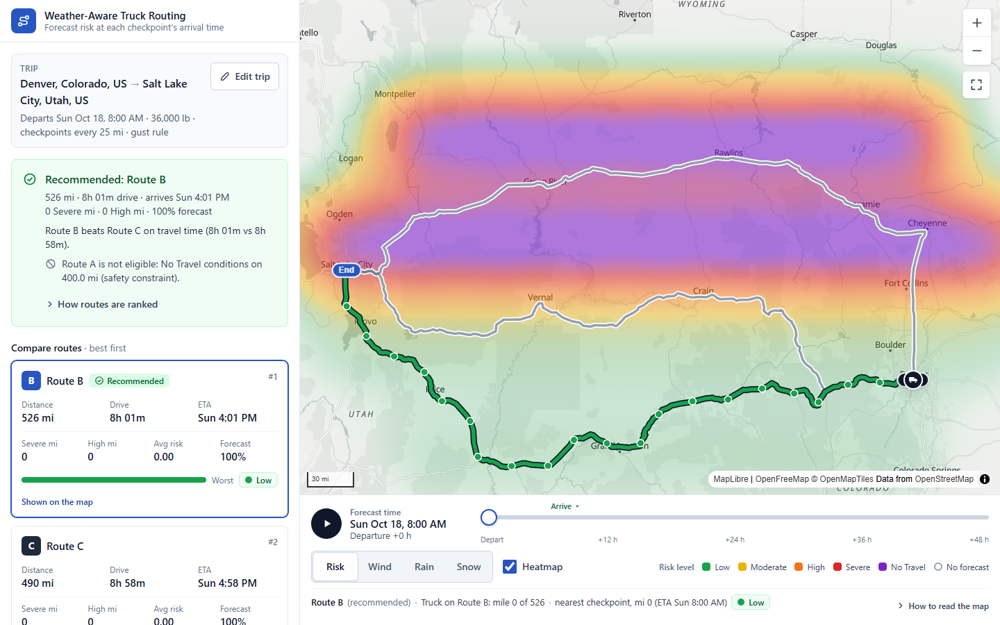
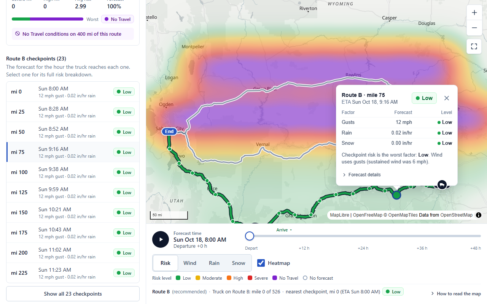
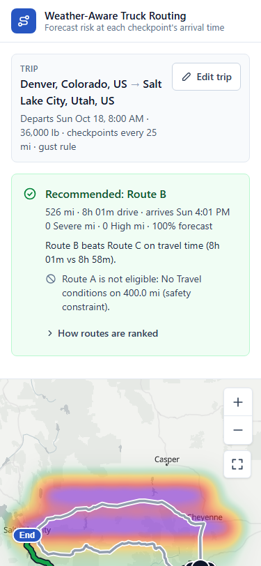
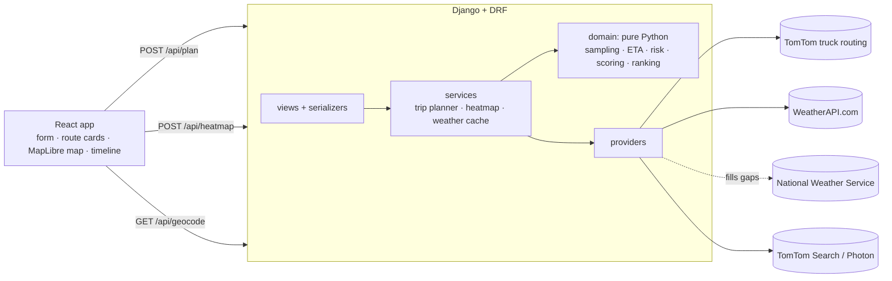

# Weather-Aware Truck Routing

A route-planning tool for truck drivers and dispatchers. It finds three truck routes, checks the forecast **for the hour the truck will actually reach each checkpoint**, scores that weather with the assessment's wind, rain, snow and load-weight rules, and recommends the safest route. All of it is shown on an interactive map with a 0–48 h weather heatmap.

| | |
|---|---|
| **Live app** | https://murtuza-truck-routing.onrender.com |
| **API health** | https://murtuza-truck-routing-api.onrender.com/api/health/ |
| **Repository** | https://github.com/murtuza777/spotter_labs_assessment |
| **Walkthrough video** | _Loom link_ |

> The API runs on Render's free tier. The first request after it has been idle takes 30–60 s while the server wakes; the page pings the API on load to start that early.



---

## Evaluate it in 5 minutes

1. **Plan a trip:** open the live app, click the **Denver → Salt Lake City** demo trip, then **Find the safest route**.
2. **Read the answer:** the banner names the recommended route and summarizes its distance, drive time, arrival, Severe and High miles and forecast coverage. It explains why the route beats each alternative; **How routes are ranked** gives the exact order.
3. **Compare routes:** click each route card. The map highlights that route and lists its checkpoints, with no new request.
4. **Check a checkpoint:** click one on the map or in the list. The details show each factor's forecast and risk level, any load-weight escalation, the forecast hour used, the grid cell and the weather source.
5. **Move through time:** drag the **0–48 h** slider or press play. The truck marker moves along the route, nearby checkpoints get a ring, and **Risk / Wind / Rain / Snow** switch the heatmap variable.
6. **Exercise the rules:**
   - **Load rules:** set the load above 30,000 or 40,000 lb on a windy day.
   - **Checkpoint spacing:** switch to 10 mi for denser checkpoints.
   - **Departure time:** move the departure up to 7 days ahead.
7. **Try a phone:** at 375 px the layout reorders to trip, answer, map and timeline, routes, checkpoints.

<p>
  
  
</p>

## Assessment requirements

| Requirement | How it is met | Where | Tests |
|---|---|---|---|
| Inputs: origin, destination, departure time, load weight | Place autocomplete, timezone-aware departure, validated load (0–80,000 lb) | [TripForm](frontend/src/features/planner/TripForm.tsx), [serializers](backend/planner/serializers.py) | API validation, e2e form |
| Three routes from a routing API | TomTom truck routing with alternatives; waypoint detours if fewer than three distinct routes come back | [plan_trip](backend/planner/services/plan_trip.py), [tomtom](backend/planner/providers/tomtom.py) | `test_services.py`, e2e detour and two-route cases |
| Weather sampled every 10, 25 or 50 mi, at the truck's ETA | ETAs from TomTom's per-point travel times; each checkpoint uses the forecast hour the truck reaches it | [sampling](backend/planner/domain/sampling.py), [eta](backend/planner/domain/eta.py), [timebucket](backend/planner/domain/timebucket.py) | `test_geo_sampling.py` |
| Risk thresholds and load rules | Exactly the brief's table; load rules escalate wind only | [risk.py](backend/planner/domain/risk.py) | `test_risk.py`: every band and load edge |
| Recommendation ranking | Fewest Severe miles → fewest High miles → lowest average risk → shortest time; No Travel routes are never recommended | [recommend.py](backend/planner/domain/recommend.py) | `test_recommend.py`: each tie-break, all orderings |
| Map with all routes, checkpoints, risk, ETAs and summaries | WebGL route, risk-segment and checkpoint layers; route cards; checkpoint details | [TripMap](frontend/src/features/map/TripMap.tsx), [RouteCard](frontend/src/features/routes/RouteCard.tsx) | e2e main flow, popup edges |
| Weather heatmap with a 0–48 h slider | 49 pre-built hourly layers cross-faded by the slider, with no API calls on slider moves | [HeatmapLayer](frontend/src/features/map/HeatmapLayer.tsx), [ForecastDock](frontend/src/features/timeline/ForecastDock.tsx) | e2e slider and no-refetch |
| Hosted | Render Blueprint: Docker API plus static site | [render.yaml](render.yaml) | live smoke test |

## Features

- **Arrival-time forecasts:** each checkpoint is scored with the forecast for the hour the truck reaches it, not the departure hour.
- **Explainable recommendation:** the pick is compared with every alternative in plain language. Each checkpoint lists its readings, levels and any load-rule escalation.
- **Safety constraints:**
  - A route with No Travel miles is never recommended.
  - A route with missing forecasts can only be a clearly labeled provisional pick.
  - Missing weather is shown as **No forecast**, never as Low.
- **Weather provider chain:** WeatherAPI.com first. The US National Weather Service fills any missing cell or value for the same location and hour. Each reading records its source, and a provider whose quota is spent is paused rather than retried.
- **Smooth map:** everything is WebGL, and the slider only changes layer opacity, so the map never reloads its data while you scrub through time.
- **Responsive and touch-friendly:**
  - From 1024 px: a scrolling side panel beside a full-height map.
  - On phones and portrait tablets: a single column, where one finger scrolls the page and two move the map.
  - Controls are 40–48 px.
  - Popups never leave the map; on small maps the checkpoint details dock inside it.
- **Accessible:** keyboard-operable throughout, one visible focus style, risk shown as text as well as color, and reduced-motion support.

## Tech stack

| Layer | Technology |
|---|---|
| Frontend | React 19, TypeScript (strict), Vite, Tailwind CSS 4, MapLibre GL via `react-map-gl`, TanStack Query (server state), Zustand (UI state) |
| Backend | Python 3.12, Django 5.2 LTS, Django REST Framework, httpx, managed with `uv` |
| Routing | TomTom Routing API (`travelMode=truck`, vehicle weight, alternatives, per-point travel times) |
| Weather | WeatherAPI.com (primary), US National Weather Service (fallback); Open-Meteo optional |
| Geocoding | TomTom Search, with Photon (OpenStreetMap) as fallback |
| Basemap | OpenFreeMap vector tiles |
| Testing | pytest + respx, Vitest, Playwright (Chromium), ruff, oxlint |
| Hosting | Render: Docker web service (API) + static site (frontend) |

## Architecture at a glance



- **Domain:** all business rules live in a pure-Python domain layer with no Django and no I/O, and are unit-tested edge by edge.
- **Providers:** third-party APIs sit behind small interfaces, and their data is normalized before anything else sees it.
- **Frontend:** it renders what the API decides. No ranking or risk logic is duplicated there.

Full details: [docs/ARCHITECTURE.md](docs/ARCHITECTURE.md).

## Run locally

Prerequisites: [uv](https://docs.astral.sh/uv/), Node 20+, and a free [TomTom key](https://developer.tomtom.com). A [WeatherAPI.com key](https://www.weatherapi.com/signup.aspx) is optional; without one, forecasts come from NWS (US only).

```bash
cd backend
cp .env.example .env          # set TOMTOM_API_KEY, optionally WEATHERAPI_KEY
uv sync
uv run python manage.py runserver        # http://127.0.0.1:8000
```

```bash
cd frontend
npm install
npm run dev                              # http://localhost:5173 (proxies /api to :8000)
```

## Tests and checks

```bash
cd backend && uv run pytest && uv run ruff check . && uv run ruff format --check .
cd frontend && npm run lint && npm run typecheck && npm test && npm run build
cd frontend && npx playwright install chromium && npm run test:e2e
```

| Suite | Count | Covers |
|---|---|---|
| Backend (pytest) | 295 | Every risk and load edge; ranking tie-breaks and orderings; sampling and ETAs; route alternatives and detours; weather normalization, fallback, quota handling and caching; API validation and error shapes. No network: providers are mocked with recorded fixtures. |
| Frontend unit (Vitest) | 17 | Polyline decoding, heatmap weights and cross-fade, truck position, formatting, weather-source labels |
| End-to-end (Playwright) | 27 | Main flow, ranking display, slider and heatmap, missing data, detours, errors, layout from 320 to 1920 px, popup placement at every map edge, touch targets, keyboard use, reduced motion |

The end-to-end tests drive the real UI and map in Chromium. Only `/api/*` and the basemap are mocked, using fixtures exported from the real backend pipeline. CI runs all three suites on every push ([workflow](.github/workflows/ci.yml)).

## Documentation

| Document | Contents |
|---|---|
| [Architecture](docs/ARCHITECTURE.md) | Components, the request lifecycle, the weather pipeline, frontend structure, map performance, error handling and security |
| [Risk model and ranking](docs/RISK_MODEL.md) | The rule table, how each ambiguity in the brief was resolved, the eligibility constraint, and a worked example |
| [API reference](docs/API.md) | Endpoints, request and response fields, error codes and rate limits |
| [Weather providers](docs/WEATHER_PROVIDERS.md) | Provider evaluation, normalization, fallback rules, measured usage and limitations |
| [How it was built](docs/DEVELOPMENT.md) | Approach, key decisions and trade-offs, testing strategy, what was verified, and next steps |
| [Deployment](docs/DEPLOYMENT.md) | Render setup, environment variables, deploying and verifying |
| [Project log](docs/project-log/) | Original plan, time log, audits and the walkthrough script |

## Known limitations

- **ETAs are pure drive time:** hours-of-service breaks aren't modeled, so on very long trips later checkpoints use slightly earlier forecast hours than a real driver would see.
- **Heatmap is a smoothed grid:** it shows real point forecasts on a 0.25–1° corridor grid, smoothed between points. It isn't radar.
- **NWS rain and snow:** NWS publishes rain and snow as 6-hour totals, so when it is the only source during precipitation, those hours stay **No forecast** rather than being guessed.
- **Free-tier hosting:** the API sleeps after 15 idle minutes.
