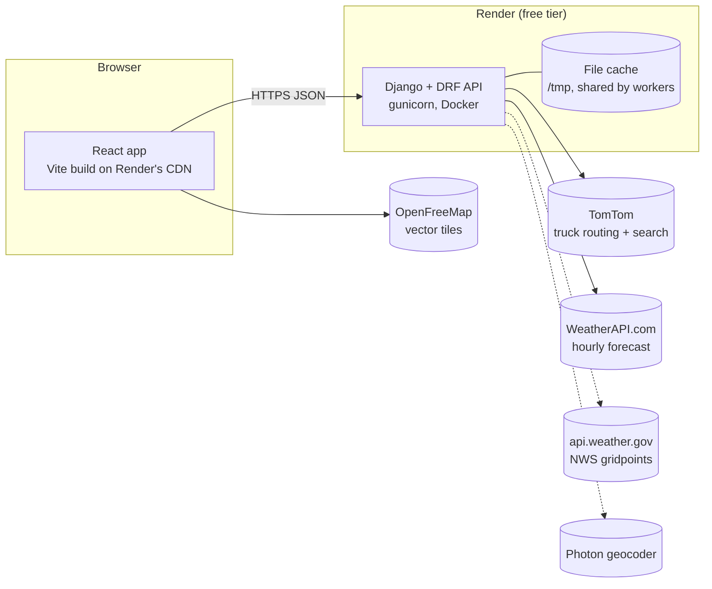
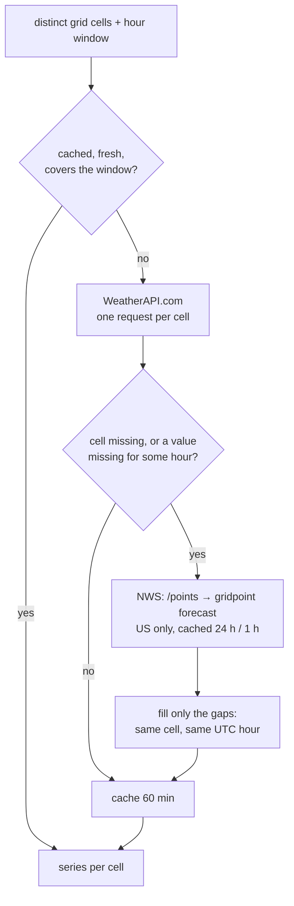
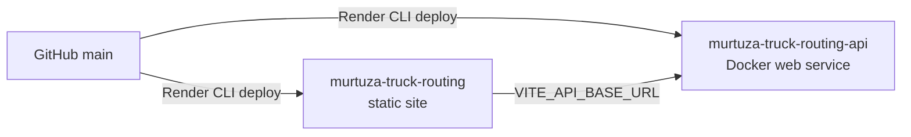

# Architecture

How the system is put together, how a trip request flows through it, and why the main pieces are shaped the way they are.

## 1. System overview



- **Frontend:** a static single-page app on Render's CDN. It never talks to third-party data APIs directly; only basemap tiles come from a third party.
- **API:** a stateless JSON service. Every API key stays on the server, and responses never include them.
- **Cache:** the only state is the cache. It holds weather per grid cell, NWS grid lookups, routing responses and provider quota "breakers", and it's shared by the gunicorn workers.

| Endpoint | Purpose |
|---|---|
| `GET /api/health/` | Wake-up and liveness check |
| `GET /api/geocode/?q=` | Place autocomplete |
| `POST /api/plan/` | Routes, checkpoints, weather, risk and the recommendation |
| `POST /api/heatmap/` | 49 hourly weather frames over the trip corridor |

The fields of each endpoint are in [API.md](API.md).

## 2. Backend layers

```
backend/planner/
  domain/      pure Python: geometry, sampling, ETAs, risk, scoring, ranking (no Django, no I/O)
  providers/   one module per third-party API, behind small interfaces in base.py
  services/    orchestration: trip planning, heatmap, weather cache and provider chain, route cache
  views.py     thin HTTP layer: validate (serializers.py), call a service, present (presenters.py)
  deps.py      builds providers and services from settings; tests swap in fakes
```

The dependency direction is one way: views → services → domain and providers. The domain imports nothing from the other layers.

| Layer | Holds | Why |
|---|---|---|
| `domain/` | `risk.py` (rule table, load rules), `sampling.py` (checkpoint placement), `eta.py` (arrival times), `timebucket.py` (forecast hour), `scoring.py` (miles per level, average risk), `recommend.py` (eligibility and ranking), `geo.py`, `corridor.py` | The graded logic is deterministic and unit-testable on its own |
| `providers/` | `tomtom.py`, `tomtom_search.py`, `photon.py`, `weatherapi.py`, `nws.py`, `openmeteo.py` | Only these modules see vendor JSON. Each converts it into the app's own types or rejects it. |
| `services/` | `plan_trip.py`, `heatmap.py`, `weather.py`, `routing.py` | Batching, caching, fallback and the order of operations |

## 3. Life of a trip request

```mermaid
sequenceDiagram
  participant UI as Browser
  participant V as /api/plan/
  participant P as TripPlanner
  participant R as Routing (cached)
  participant W as WeatherService
  participant D as Domain
  UI->>V: origin, destination, departure, load, spacing, wind rule
  V->>V: validate (timezone-aware, ≤ 7 days ahead, ≤ 80,000 lb)
  V->>P: plan(request)
  P->>R: TomTom truck routes (weight = load + 35,000 lb tare, 2 alternatives)
  R-->>P: up to 3 routes with per-point travel times
  P->>P: drop near-duplicates; add waypoint detours if fewer than 3
  P->>D: place checkpoints every N mi; ETA from TomTom travel times
  D-->>P: checkpoints with ETA, forecast hour, 0.25° grid cell
  P->>W: series for all distinct cells over the trip's hours
  W-->>P: normalized hourly series (cache, then provider chain)
  P->>D: assess each checkpoint, score miles per level, rank
  D-->>P: risk, summaries, eligibility, recommendation
  P-->>V: TripPlan
  V-->>UI: JSON (routes, checkpoints, recommendation, notices, meta)
  UI->>UI: render; then POST /api/heatmap/ for the 0–48 h frames
```

**Routes**
- TomTom is asked for truck routes for the rig's gross weight: the load plus an empty 35,000 lb tractor-trailer.
- Alternatives that share 95 % or more of their road with another route count as duplicates.
- If fewer than three distinct routes remain, the planner asks for detours through waypoints placed to the side of the main route. A detour is kept only if it shares at most 85 % of its road with the others, is at most 1.4× the distance and 1.5× the drive time, and doesn't double back.
- Identical requests within 10 minutes reuse the routing response.

**Checkpoints and ETAs**
- A checkpoint is placed every 10, 25 or 50 mi along each route, plus one at the destination.
- Each checkpoint's ETA is interpolated from TomTom's travel time at each point. City stretches are slow and interstates fast, rather than using one average speed.
- The forecast hour is the ETA rounded up to the next hour. Every weather value is normalized to the hour ending at its timestamp, so a truck passing at 14:20 is scored with the hour ending 15:00.

**Weather lookup**
- Checkpoints are snapped to a 0.25° grid, and checkpoints that share a cell share one forecast series. Denver → Salt Lake City at 25 mi spacing is 67 checkpoints in 59 cells.
- One cached series covers at least the next 72 h, so the heatmap reuses the plan's cells.

**Scoring and the recommendation**
- Each checkpoint owns the miles from the midpoint with its previous checkpoint to the midpoint with its next, so the miles per level add up exactly to the route length.
- Routes are checked for eligibility first: no No Travel miles, and enough forecast coverage. Eligible routes are then ranked by the four criteria.

The rules are in [RISK_MODEL.md](RISK_MODEL.md).

## 4. Weather pipeline



- **One schema:** every provider converts its response into `HourlySeries`: wind and gusts in mph, rain and snow in in/hr, one value per hour ending at a UTC stamp. Missing or invalid values are `None`, meaning unknown, never zero. Units can't mix because conversion happens inside each provider module.
- **Field-level fallback:** NWS is asked only about cells WeatherAPI couldn't serve, or values it left empty. It never replaces a WeatherAPI value, and it fills a value only from the same cell and the same hour. Each value records which provider supplied it, so checkpoints and heatmap points carry their source.
- **Validation:**
  - WeatherAPI answers for a place more than 20 mi from the cell are rejected.
  - NWS forecasts older than 24 h, gridpoints more than 3 mi from the cell, unknown units and off-the-hour times are rejected.
  - NWS 6 h precipitation totals are used only when they are exactly zero or cover exactly one hour, because a total can't be turned into an hourly rate.
- **Failure handling:**
  - Timeouts and 5xx errors get bounded retries with backoff.
  - A spent quota, a rejected key or a persistent rate limit opens a breaker in the cache, and that provider is skipped until its reset time.
  - Cells nothing could fill stay unknown, and a notice says which provider failed and why.
- **Cost control:**
  - One request per cell, not per checkpoint.
  - The cache is shared by the plan and the heatmap.
  - Moving the slider, switching the variable or selecting a route makes no request.

Measured numbers and provider limits are in [WEATHER_PROVIDERS.md](WEATHER_PROVIDERS.md).

## 5. Heatmap

`POST /api/heatmap/` takes the plan's route geometries and returns a corridor grid:
- **Grid:** points within 60 mi of any route, starting at the weather grid's 0.25° spacing and widening if there would be more than 220 points.
- **Hours:** 49 hourly frames from the departure hour.
- **Metrics:** risk, wind, rain and snow.

Cells without a forecast for an hour are `null` and appear as grey dots, never as an untinted gap that could read as calm.

## 6. Frontend

```
frontend/src/
  api/          typed client and TanStack Query hooks (plan mutation, heatmap query, place search)
  store/        Zustand store: selected/hovered route, slider hour, playback, heatmap variable, open checkpoint
  features/
    planner/    trip form, place autocomplete, trip summary, progress
    routes/     recommendation banner, route cards, risk-miles bar, checkpoint list
    map/        MapLibre map, route/checkpoint layers, heatmap layers, checkpoint popup or docked details
    timeline/   forecast dock: slider, playback, heatmap variable, color key, credits
  components/   shared UI: risk badge, segmented control, form field, disclosure, icons
  lib/          pure helpers: polylines, heatmap math, risk colors, route model, formatting
```

- **State:** server data (plan, heatmap, place search) lives in TanStack Query; UI state lives in a small Zustand store.
  - Only the latest plan request can update the screen.
  - The heatmap is keyed by its plan, so a stale response can't overwrite a newer plan.
  - Selecting a route or moving the slider changes only store state.
- **No business logic in the browser:** ranking, eligibility and risk come from the API. The frontend only formats and draws them.
- **Loading:** the map and MapLibre (about 1 MB) are lazy-loaded, so the form is usable immediately.

### Layout

One DOM serves every screen size, so the map is never rebuilt when the window is resized or a tablet is rotated.

| Width | Layout |
|---|---|
| ≥ 1024 px | A scrolling side panel (trip, recommendation, route comparison, checkpoints) beside a full-height map, with the forecast timeline docked under the map |
| < 1024 px | One column in reading order: header, trip, recommendation, map, timeline, routes, checkpoints. Implemented with `display: contents` and CSS `order`. |

- **Touch:** in the single-column layout on touch screens, one finger scrolls the page and two move the map (MapLibre cooperative gestures), so the map never traps scrolling.
- **Checkpoint details:** shown in a MapLibre popup with automatic placement, kept 12 px inside the map edges. Maps smaller than 560×520 px dock the same details inside the map instead (below the point on narrow maps, beside it on short wide ones), so the details are never clipped.

### Map rendering

Everything on the map is WebGL except the truck and the two trip endpoints, which are DOM markers.

| Layer | Purpose |
|---|---|
| `route-inactive-casing`, `route-inactive` | Alternatives, highlighted on hover |
| `route-selected-casing`, `route-selected-risk` | The selected route, colored by risk segment |
| `route-selected-unknown`, `route-selected-unknown-dash` | Stretches with no forecast: dashed grey |
| `route-hit` | Wide invisible line for easy clicking |
| `checkpoints` | Risk-colored dots; no forecast is a hollow ring |
| `weather-heatmap-0` … `-48` | One heatmap layer per hour |
| `weather-unknown-0` … `-48` | Grey dots for cells without a forecast that hour |

**Why 49 heatmap layers:** changing a data-driven paint property (such as the heatmap weight) makes MapLibre re-process the source on every frame, which stutters. Instead, all 49 hourly layers are built once per response, and the slider only cross-fades `heatmap-opacity` between the two neighbouring hours. MapLibre skips layers at opacity 0. Checkpoints near the slider time, and the open checkpoint, are highlighted with feature-state, which doesn't re-process the source either. Measured: 0 source reloads over 40 slider moves.

**Heatmap math:** every metric is mapped onto the same 0–4 risk scale, so one color ramp and one legend serve risk, wind, rain and snow. The kernel radius and intensity are derived from the grid spacing, so the field stays smooth at any zoom.

**Payloads:** geometry is simplified on the server (Douglas–Peucker, 30 m tolerance) and sent as encoded polylines, and responses are gzipped. A heatmap is about 6 KB on the wire.

## 7. Errors, security and observability

- **One error shape:** `{"error": {"code", "message", "details"?}}` for every failure, including 404 and 500 responses. The form maps `details` onto its fields.
- **Validation:**
  - Departure times must include a timezone and be within 1 h in the past to 7 days ahead.
  - Load is limited to 0–80,000 lb.
  - Spacing must be 10, 25 or 50 mi.
  - Origin and destination must be at least 1 mile apart.
- **Rate limits:** `/plan/` and `/heatmap/` allow 20 requests a minute per client; other endpoints allow 120.
- **Secrets:** keys live only in server environment variables. They're sent to providers server-side, scrubbed from error messages, and kept out of logs (the HTTP client's URL logging is turned down). The frontend bundle contains no keys or provider URLs.
- **Transport and headers:** HSTS, `nosniff` and frame denial are on. CORS allows only the frontend origin. The API is stateless, with no cookies or sessions.
- **Observability:**
  - Every plan logs its routing and weather counts and timings.
  - Each weather provider call logs its name, status counts, cells and latency, and a breaker opening logs a warning with the reason.
  - The same counts are returned in each response's `meta`.

## 8. Deployment



Both services are defined in one Render Blueprint ([`render.yaml`](../render.yaml)). Setup, environment variables and verification are in [DEPLOYMENT.md](DEPLOYMENT.md).
